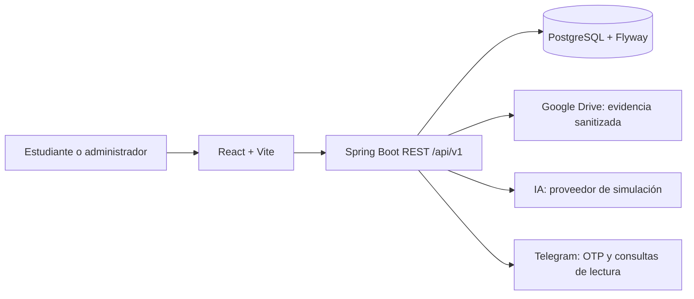
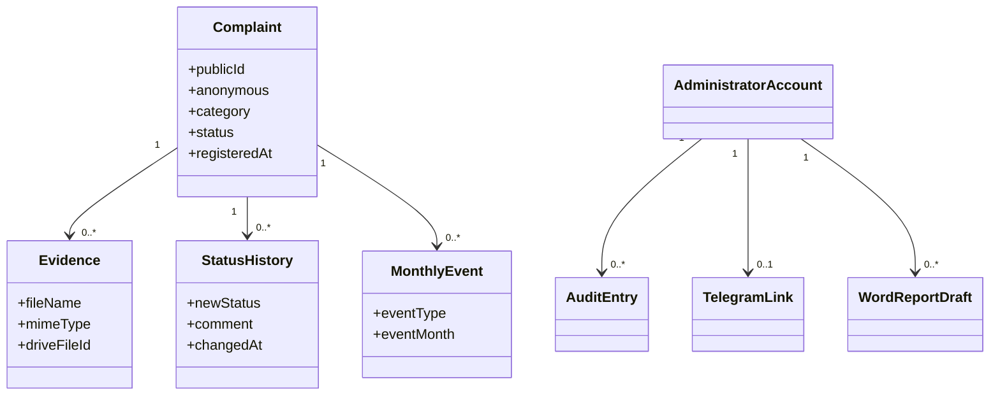

# Buzón UCC — Formulario de Quejas Académicas

Plataforma web mobile-first para recibir quejas académicas anónimas o
identificadas, gestionar su seguimiento y generar información administrativa
con privacidad y trazabilidad.

## Objetivo

Facilitar un canal institucional seguro para registrar quejas, proteger la
identidad y las evidencias, permitir la gestión de una cuenta administrativa y
conservar un historial verificable hasta el cierre mensual.

El objetivo se cumplió con el flujo Specify y sus artefactos en
[`specs/002-academic-complaints/`](specs/002-academic-complaints/). El detalle
de arquitectura, módulos, seguridad, datos y operación está en el
[`informe técnico`](docs/informe-tecnico.md).

## Funcionalidades principales

- Formulario público con 11 categorías, modalidad anónima o identificada y
  validaciones de asunto, descripción y número de ubicación.
- Evidencias JPG/JPEG/PNG sanitizadas, hasta cinco imágenes de 100 MB cada una.
- Panel administrativo con filtros, detalle, enlaces de evidencia y exportación
  Excel.
- Estados `Pendiente`, `Completada` y `No completada`, historial inmutable y
  seguimiento mensual.
- Dashboard con estadísticas semanales/mensuales y predicciones claramente
  separadas de los datos reales.
- Reportes Word editables con siete secciones.
- Cuenta administrativa única con sesión, recuperación, lockout y auditoría.
- Telegram desacoplado con OTP, avisos mínimos y comandos de solo lectura.

## Arquitectura resumida



## Diagrama de clases



Para el diagrama completo y la explicación de cada capa, consulte
[`docs/informe-tecnico.md`](docs/informe-tecnico.md).

## Prerrequisitos

- Java 21
- Maven 3.9+
- Node.js y npm
- Docker para Compose y validaciones de integración

## Configuración

Copie `infra/.env.example` a un archivo `.env` local y complete los valores
fuera del repositorio. Nunca escriba credenciales, tokens ni claves en el
código o la documentación.

Para desarrollo local, use `AI_PROVIDER=simulation`. Google Drive y Telegram
solo deben considerarse conectados después de configurar sus variables y
ejecutar la validación correspondiente.

## Ejecución

```powershell
cd backend
mvn spring-boot:run
cd ..\frontend
npm install
npm run dev
```

## Comprobaciones reproducibles

```powershell
cd backend
mvn verify
cd ..\frontend
npm ci
npm run lint
npm test
npm run build
cd ..
docker compose -f infra/compose.yaml --env-file infra/.env.example config
```

## Flujo Specify utilizado

Los comandos se ejecutaron en este orden, uno a uno:

1. `/speckit.specify` — crear la especificación funcional.
2. `/speckit.plan` — definir arquitectura y plan técnico.
3. `/speckit.tasks` — generar tareas y dependencias.
4. `/speckit.implement` — implementar las tareas por fases.
5. `/speckit.analyze` — analizar consistencia entre artefactos.
6. `/speckit.checklist` — verificar requisitos y cierre.

> Los nombres correctos son `/speckit.specify` y `/speckit.plan`; no
> `/specifi-plan`.

## Documentación

- [Informe técnico completo](docs/informe-tecnico.md)
- [Especificación](specs/002-academic-complaints/spec.md)
- [Plan técnico](specs/002-academic-complaints/plan.md)
- [Tareas completadas](specs/002-academic-complaints/tasks.md)
- [Validación operativa](specs/002-academic-complaints/quickstart.md)
- [Documentación operativa](docs/README.md)
