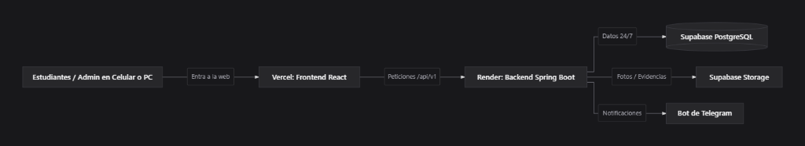

# Guía de Despliegue en la Nube: Vercel y Render (Buzón UCC)

Esta guía explica paso a paso cómo publicar el proyecto en internet para que funcione **24/7 de forma pública y gratuita**, utilizando:
* **Vercel** para el Frontend (React + Vite).
* **Render** para el Backend (Java 21 + Spring Boot).
* **Supabase** para la Base de Datos (PostgreSQL 17.11) y Almacenamiento de Evidencias (Storage).



---

## 1. Subir el proyecto a GitHub

> **Nota de seguridad**: Verifica que los archivos `.env` y `backend/.env` **no** se suban a GitHub. Los archivos ya están ignorados en `.gitignore`.

1. Abre tu terminal en la raíz del proyecto (`Web_Buzon_Agente`).
2. Verifica los cambios listos para subir:
   ```bash
   git status
   ```
3. Agrega todos los archivos preparados:
   ```bash
   git add .
   ```
4. Haz commit:
   ```bash
   git commit -m "feat: configuracion de despliegue para Vercel y Render, integracion Supabase Storage y tracking publico"
   ```
5. Sube tus cambios a tu repositorio de GitHub:
   ```bash
   git push origin master
   ```

---

## 2. Despliegue del Backend en Render

1. Entra a [render.com](https://render.com) e inicia sesión con tu cuenta de GitHub.
2. Haz clic en **New +** -> **Web Service**.
3. Selecciona tu repositorio de GitHub (`Web_Buzon_Agente`).
4. Configuración básica:
   * **Name**: `buzon-ucc-backend` (o el nombre que elijas).
   * **Region**: Oregon (US West) u Ohio.
   * **Branch**: `master` (o `main`).
   * **Root Directory**: `backend` (o déjalo en blanco si usas el Dockerfile de la raíz).
   * **Runtime**: **Docker**.
   * **Dockerfile Path**: `./backend/Dockerfile`.
   * **Instance Type**: **Free** (0.5 CPU, 512 MB RAM).
5. **Variables de Entorno (Environment Variables)**:
   Haz clic en **Add Environment Variable** y agrega las siguientes (toma los valores de tu `.env` de Supabase y Telegram):
   * `PORT`: `8081`
   * `SPRING_PROFILES_ACTIVE`: `prod`
   * `DATABASE_URL`: `jdbc:postgresql://aws-0-<REGION>.pooler.supabase.com:5432/postgres?sslmode=require` *(Usar el host del **Connection Pooler en Session Mode** en Supabase > Project Settings > Database > Connection pooler, ya que Render requiere IPv4)*
   * `DATABASE_USERNAME`: `postgres.<PROJECT-REF>` *(En el pooler de Supabase el usuario debe ser `postgres.[PROJECT-REF]`)*
   * `DATABASE_PASSWORD`: `<TU_PASSWORD_DE_POSTGRES_SUPABASE>`
   * `SUPABASE_URL`: `https://<PROJECT-REF>.supabase.co`
   * `SUPABASE_SECRET_KEY`: `<TU_SUPABASE_SERVICE_ROLE_SECRET_KEY>`
   * `SUPABASE_PUBLISHABLE_KEY`: `<TU_SUPABASE_PUBLISHABLE_KEY>`
   * `TELEGRAM_ENABLED`: `true`
   * `TELEGRAM_LONG_POLLING`: `true`
   * `TELEGRAM_BOT_TOKEN`: `<TU_TELEGRAM_BOT_TOKEN>`
   * `TELEGRAM_WEBHOOK_SECRET`: `<TU_TELEGRAM_WEBHOOK_SECRET>`
   * `TELEGRAM_ENCRYPTION_SECRET`: `<TU_TELEGRAM_ENCRYPTION_SECRET>`
   * `AI_PROVIDER`: `simulation`
6. Haz clic en **Create Web Service**.
7. Espera unos 3-4 minutos a que termine de compilar. Al finalizar, Render te dará tu URL pública, por ejemplo:
   `https://buzon-ucc-backend.onrender.com`

El perfil `prod` configura la cookie de sesión como `SameSite=None; Secure`, necesaria para que el navegador envíe la sesión administrativa desde el frontend de Vercel al backend de Render.

---

## 3. Despliegue del Frontend en Vercel

1. Entra a [vercel.com](https://vercel.com) e inicia sesión con GitHub.
2. Haz clic en **Add New...** -> **Project**.
3. Selecciona tu repositorio `Web_Buzon_Agente` y haz clic en **Import**.
4. En la configuración del proyecto:
   * **Framework Preset**: `Vite` (lo detecta automáticamente).
   * **Root Directory**: Haz clic en **Edit** y selecciona la carpeta **`frontend`**.
   * **Build Command**: `npm run build`
   * **Output Directory**: `dist`
5. **Variables de Entorno (Environment Variables)**:
   * Despliega la sección **Environment Variables**.
   * Agrega:
     * **Key**: `VITE_API_URL`
     * **Value**: La URL que te dio Render (ej. `https://buzon-ucc-backend.onrender.com`).
6. Haz clic en **Deploy**.
7. En menos de 1 minuto estará listo con tu dominio público gratuito (ejemplo: `https://buzon-ucc.vercel.app`).

---

## 4. Verificación de Funcionamiento en Producción

1. Abre la URL de Vercel en tu navegador o celular.
2. Radica una queja de prueba con una foto adjunta.
3. Copia el radicado recibido y verifícalo en la pestaña **"Consultar Radicado"**.
4. Entra al panel de administración (pulsando el logo) y verifica que el expediente muestre la foto alojada en Supabase Storage.
