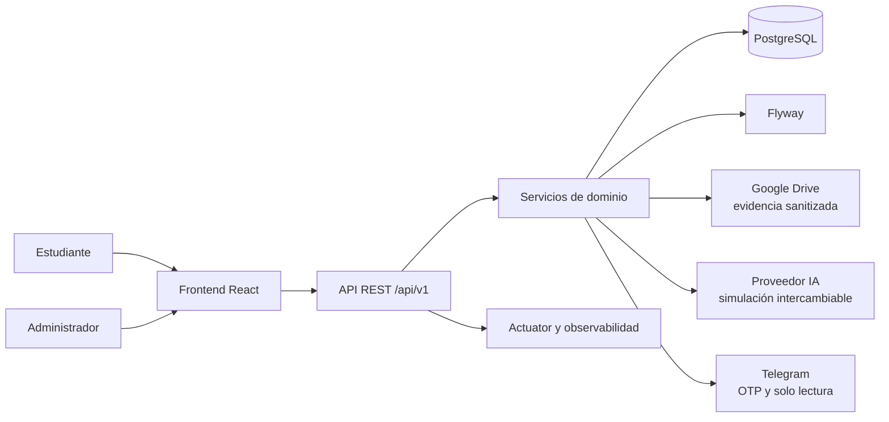
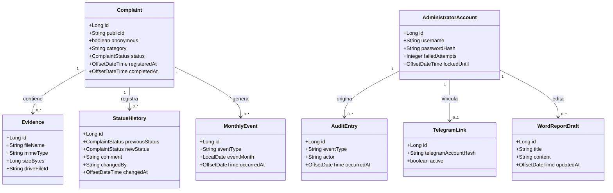

# Informe técnico — Buzón UCC

## 1. Resumen ejecutivo

Buzón UCC es una plataforma web mobile-first para registrar, administrar y
dar seguimiento a quejas académicas. La solución separa el formulario público
del panel administrativo protegido y aplica privacidad por diseño: permite
envíos anónimos o identificados, sanitiza imágenes, limita el acceso a una
única cuenta administrativa y evita enviar identidad o evidencias a los
servicios de IA y Telegram.

El proyecto se implementó como monorepo con frontend React, backend Spring
Boot, PostgreSQL, migraciones Flyway y una capa de adaptadores para Google
Drive, IA y Telegram.

## 2. Objetivo y alcance cumplido

### Objetivo

Proporcionar un canal institucional seguro para recibir quejas académicas,
conservar sus evidencias, permitir la gestión administrativa trazable y
generar información útil para seguimiento y toma de decisiones humanas.

### Alcance entregado

- Registro anónimo o identificado sin cuentas de estudiante.
- Once categorías, validación de campos y evidencia JPG/JPEG/PNG.
- Hasta cinco imágenes de 100 MB por imagen, con sanitización de metadatos.
- Consulta, filtros, detalle y exportación Excel para el administrador.
- Estados `Pendiente`, `Completada` y `No completada`, con historial y
  seguimiento mensual.
- Dashboard semanal/mensual con datos reales y predicciones etiquetadas como
  estimaciones cuando se alcanza el mínimo definido.
- Reportes Word con siete secciones, edición previa y evidencia local.
- Cuenta administrativa única, sesión, recuperación, lockout y auditoría.
- Telegram con vinculación, OTP, avisos mínimos y comandos de solo lectura.
- Health checks, observabilidad, Docker, Compose y flujos de CI/CD.

## 3. Arquitectura de la solución



### Capas principales

1. **Presentación**: React, Vite, componentes por funcionalidad, formularios
   accesibles y cliente HTTP centralizado.
2. **API**: controladores versionados bajo `/api/v1`, DTOs, validación y
   respuestas de error uniformes en español.
3. **Dominio y aplicación**: servicios para quejas, estados, dashboard,
   reportes, auditoría, autenticación, Telegram y almacenamiento.
4. **Persistencia**: entidades JPA, repositorios Spring Data y migración
   Flyway para PostgreSQL.
5. **Adaptadores externos**: Google Drive, proveedor de IA y cliente Telegram,
   aislados para poder simularlos o probarlos con mocks.

## 4. Diagrama de clases



## 5. Funcionalidades y endpoints

| Área | Endpoints principales |
|---|---|
| Público | `GET /api/v1/public/form-options`, `POST /api/v1/public/complaints` |
| Salud | `GET /api/v1/health`, Actuator health |
| Administración | `GET /api/v1/admin/complaints`, detalle y `export.xlsx` |
| Estados | `PATCH /api/v1/admin/complaints/{id}/status`, historial y seguimiento mensual |
| Dashboard | `GET /api/v1/admin/dashboard` |
| Reportes | Crear, consultar, editar y descargar borradores Word |
| Cuenta | Login, OTP, logout, sesión, recuperación y cambio de credenciales |
| Telegram | Vincular, confirmar, desvincular, notificaciones y webhook |

## 6. Modelo de datos y privacidad

PostgreSQL conserva metadatos de quejas, evidencias, estados, eventos
mensuales, auditoría, cuenta administrativa, desafíos protegidos, vínculo
Telegram y borradores Word. Los binarios de imágenes no se guardan en la base
de datos: se almacenan en Google Drive mediante referencias persistidas.

Las reglas relevantes son:

- La modalidad anónima elimina la identidad antes de persistirla.
- Las imágenes se validan por tipo, cantidad y tamaño y se sanitizan antes de
  subirlas.
- La IA recibe datos de análisis, nunca nombres, semestres ni imágenes.
- Telegram recibe payloads mínimos y no permite mutaciones ni descargas.
- Contraseñas, OTP, respuestas de seguridad y secretos no se registran en
  código, documentación ni logs.
- Las auditorías registran actor, evento y momento sin contenido sensible.

## 7. Tecnologías y calidad

- **Backend**: Java 21, Spring Boot 3.5.7, Web, JPA, Security, Validation,
  Actuator, Flyway y PostgreSQL.
- **Frontend**: React 19, Vite, JavaScript, Recharts y Vitest.
- **Documentos**: Apache POI para Excel y Word.
- **Pruebas**: JUnit, Mockito, MockMvc, Testcontainers, Vitest y pruebas de
  privacidad, accesibilidad, seguridad y rendimiento.
- **Calidad**: JaCoCo con umbral configurado del 80 %, Checkstyle, SpotBugs,
  Find Security Bugs, ESLint y OWASP Dependency-Check.
- **Entrega**: Dockerfile multietapa, Docker Compose y workflows separados de
  CI y despliegue.

## 8. Flujo de trabajo utilizado

El desarrollo siguió el flujo Specify, manteniendo la trazabilidad en
`specs/002-academic-complaints/`:

1. `/speckit.specify` — definición de historias, reglas y criterios de
   aceptación en `spec.md`.
2. `/speckit.plan` — selección de arquitectura, tecnologías, estructura y
   riesgos en `plan.md`.
3. `/speckit.tasks` — descomposición en tareas T001-T094 y dependencias en
   `tasks.md`.
4. `/speckit.implement` — implementación incremental por fases e historias.
5. `/speckit.analyze` — revisión de consistencia entre especificación, plan y
   tareas.
6. `/speckit.checklist` — verificación final de requisitos y criterios de
   aceptación.

El resultado del flujo quedó reflejado en las tareas marcadas como
completadas y en la documentación operativa del proyecto.

## 9. Ejecución y operación

Para una validación reproducible, consultar
[`quickstart.md`](../specs/002-academic-complaints/quickstart.md). Los comandos
principales son:

```powershell
cd backend
mvn verify
cd ..\frontend
npm ci
npm run lint
npm test
npm run build
cd ..
docker compose -f infra/compose.yaml --env-file infra/.env.example config
```

Las integraciones Google Drive y Telegram requieren variables de entorno
externas. `AI_PROVIDER=simulation` permite desarrollo y pruebas deterministas
sin exponer secretos.

## 10. Cierre

El proyecto cumple el objetivo funcional y técnico definido en la
especificación: ofrece recepción segura, administración controlada,
seguimiento, análisis, generación documental e integraciones desacopladas.
La plataforma queda documentada para operación, mantenimiento y futuras
validaciones de despliegue con credenciales y servicios reales.
